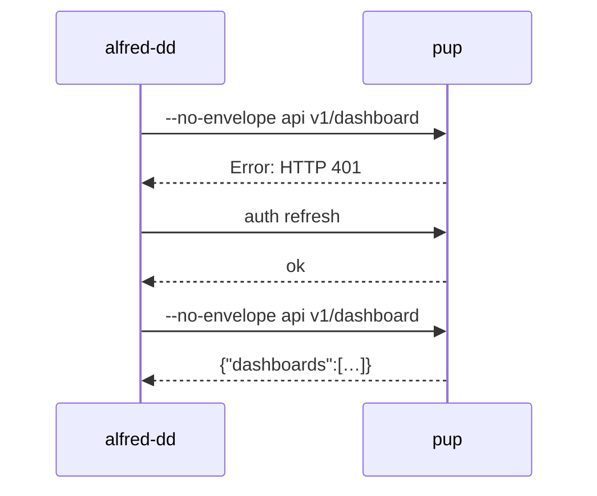
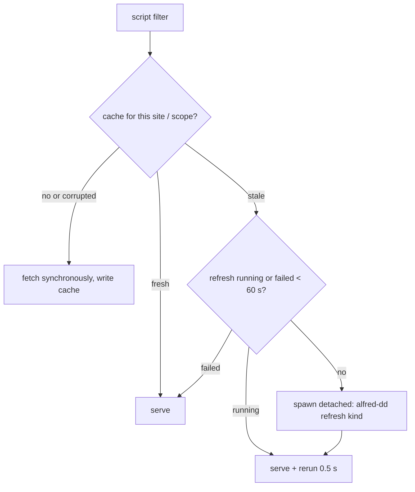

# Architecture

## Overview

The workflow is a single Rust binary, `alfred-dd`, with one subcommand per
object in the Alfred workflow graph:

| Subcommand               | Alfred object                | Keyword | Responsibility |
| ------------------------ | ---------------------------- | ------- | -------------- |
| `alfred-dd run <arg>`    | Run Script (`action.script`) | —       | Decode the selected item's `arg` and perform it. |

Every script filter is connected to the single Run Script, itself connected to
a Post Notification that shows whatever `run` prints (copies, refreshes,
errors).

The workflow is **read-only**: it never writes to Datadog.

## The `arg` protocol

Script filter items do not carry raw data: their `arg` — and the `arg` of each
modifier (`mods`) — is an encoded [`Action`](../src/action.rs):
`"<verb> <payload>"`. `run` decodes it with `Action::parse` and performs it
with `action::execute`.

| Verb       | Payload    | Effect |
| ---------- | ---------- | ------ |
| `open-url` | `<url>`    | Open the URL. |
| `copy`     | `<text>`   | Copy the text. |
| `search`   | `<query>`  | Reopen Alfred on that query (e.g. `ddd `); the trailing space is kept. |

Fields are ordered so that only the last one may contain spaces; URLs, keys
and kinds never do. A round-trip test covers every verb.

Each script filter declares connections for every modifier (none,
<kbd>⌘</kbd>, <kbd>⌥</kbd>, <kbd>⌃</kbd>, <kbd>⇧</kbd>, <kbd>⇧⌘</kbd>), all to
the same Run Script, so a modifier's `arg` always reaches `run`.

## Configuration

Alfred passes workflow variables to the binary as environment variables:

| Variable  | Default        | Used for |
| --------- | -------------- | -------- |
| `DD_SITE` | `datadoghq.eu` | Every link (`https://app.<DD_SITE>/…`). |
| `DD_ENV`  | `production`   | Default env of services, logs, traces and monitors. |

## Talking to Datadog

Every read goes through the [`pup`](https://github.com/DataDog/pup) CLI,
logged in with OAuth (`pup auth login`):

```
/opt/homebrew/bin/pup --no-envelope api <endpoint>
```

`pup api` is a raw authenticated GET: stdout is the Datadog API body, the
shapes are the public API's. pup's dedicated subcommands (`dashboards list`,
`monitors search`, `incidents list`, `service-catalog list`) were tried first
but answer `403 Failed permission authorization checks` with the same OAuth
token, so they are not used.

pup is resolved by absolute path (`/opt/homebrew/bin/pup`, then
`/usr/local/bin/pup`) because Alfred does not load the shell `PATH`. `main`
sets `PUP_NO_UPDATE_CHECK=1` (no GitHub call from pup) and `DD_SITE`.

Failures are classified from pup's stderr:

| stderr contains | Meaning | What the user sees |
| --------------- | ------- | ------------------ |
| `failed to spawn` | pup missing | "pup is not installed" with the `brew install` command |
| `authentication required`, `no tokens found` | no session | "Run `pup auth login`" |
| `authentication expired`, `HTTP 401` | expired session | `pup auth refresh`, then one retry; still failing ⇒ "Run `pup auth login`" |
| `HTTP 403` | missing permission | the scope the source needs (`dashboards_read`, …) |
| `HTTP 429`, `rate limited`, exit status 173 | rate limit | "retry in a few seconds" |
| anything else | — | pup's `Error:` line |



## Cache

One JSON file per source in `$alfred_workflow_cache`
(`<kind>.json`: `{key: {site, scope}, fetched_ms, items}`), served
stale-while-revalidate:

| Kind         | TTL    | Key scope |
| ------------ | ------ | --------- |
| `dashboards` | 1 h    | — |
| `notebooks`  | 1 h    | — |
| `services`   | 1 h    | env |
| `monitors`   | 2 min  | — |
| `incidents`  | 60 s   | — |



- `refresh <kind>` takes `<kind>.lock` (`create_new`; a lock older than 60 s
  is abandoned and taken over), fetches, writes atomically (temp file +
  rename) and releases the lock. A failure leaves `<kind>.failed` so reruns
  do not respawn it for 60 s.
- Freshness is computed against the injected clock (`cache::freshness`).

## Ranking and frecency

- Names are normalized (lowercase, Latin accents folded) and every free term
  must appear. Tier: exact name > name prefix > every term starts a word >
  substring.
- Within a tier: frecency score, then the source's tie-breaker.
- Frecency (`$alfred_workflow_data/frecency.json`) counts the opens of each
  `<kind>:<id>` made through the `open` action; score = count × 0.5^(age /
  7 days). On an empty query it is the primary order.

## Design decisions

- **Everything is a pure function except one trait.** The only side-effecting
  boundary — spawning `pup`, `osascript` and `open` — is `runner::CommandRunner`
  (`SystemRunner` in prod, `FakeRunner` in tests). Its `spawn_detached` starts
  a process in its own process group with no stdio and returns at once.
- **Injected clock**: `App::now_ms` is read once per invocation; nothing else
  reads the system time.
- **No `uid` on items**: Alfred would re-sort by its own usage knowledge.
  Filtering and ordering happen in Rust (`alfredfiltersresults = false`).
- **Script filters never hard-fail**: errors become an invalid Alfred item.
- **No artwork**: item icons are macOS system icons (`alfred::icons`), the
  workflow icon is converted from one (`scripts/icon.sh`).
