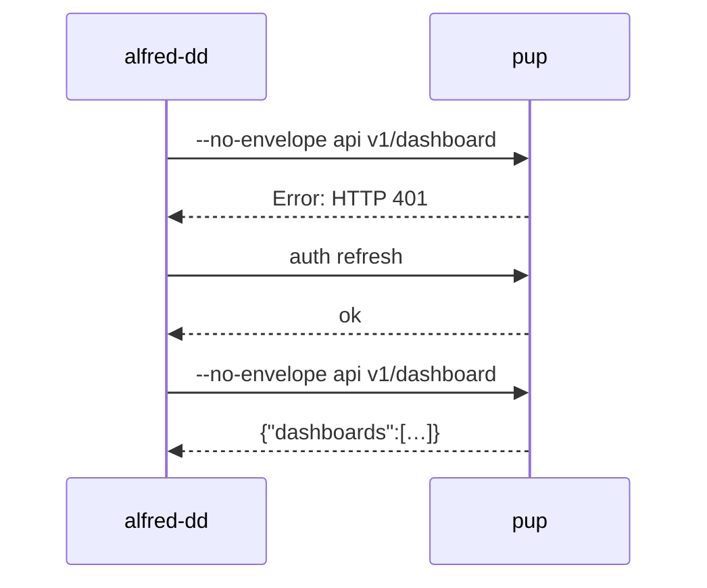
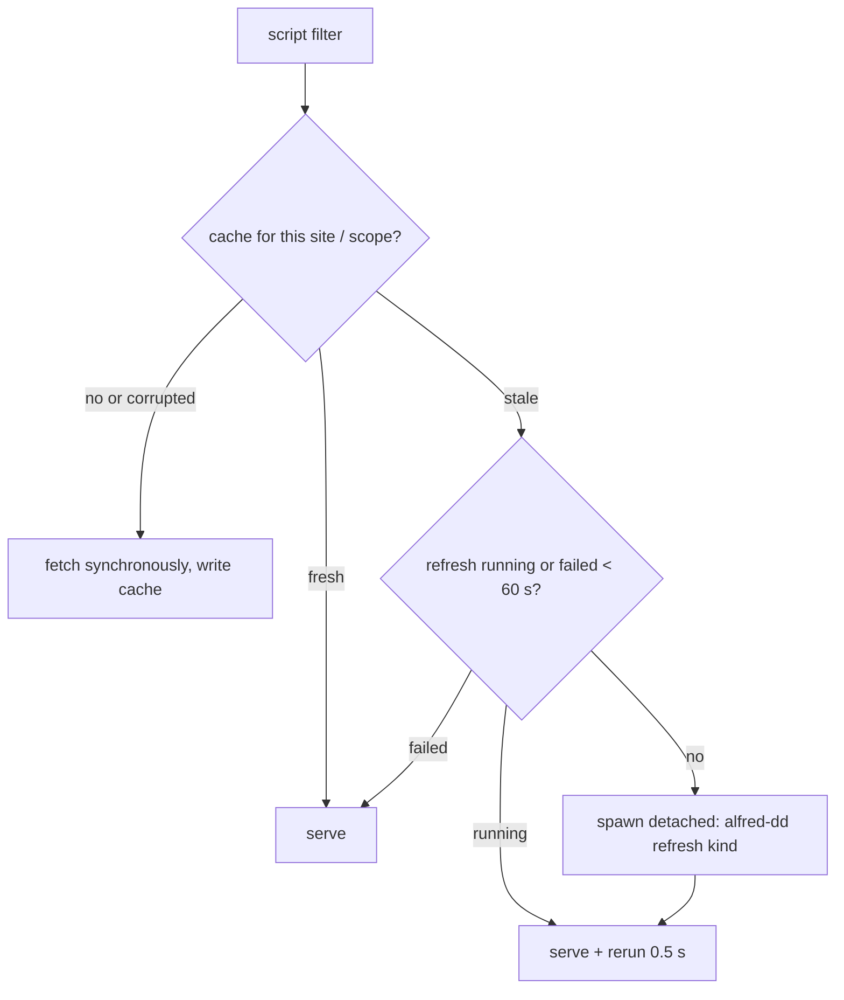

# Architecture

## Overview

The workflow is a single Rust binary, `alfred-dd`, with one subcommand per
object in the Alfred workflow graph:

| Subcommand                     | Alfred object                | Keyword | Responsibility |
| ------------------------------ | ---------------------------- | ------- | -------------- |
| `alfred-dd home [query]`       | Script Filter                | `dd`    | What the query or clipboard points at, then every keyword. |
| `alfred-dd dashboards [query]` | Script Filter                | `ddd`   | Dashboards and notebooks, ranked. |
| `alfred-dd services [query]`   | Script Filter                | `dds`   | APM services of an env, with their links. |
| `alfred-dd monitors [query]`   | Script Filter                | `ddm`   | Monitors of an env, alerting first. |
| `alfred-dd incidents [query]`  | Script Filter                | `ddi`   | Active and stable incidents, most severe first. |
| `alfred-dd logs [query]`       | Script Filter                | `ddl`   | Log Explorer link from the query (no API call); `service:` completions from the services cache. |
| `alfred-dd refresh <kind> [env]` | — (spawned detached)       | —       | Refresh one cached source in the background (`env` for services). |
| `alfred-dd run <arg>`          | Run Script (`action.script`) | —       | Decode the selected item's `arg` and perform it. |

Every script filter is connected to the single Run Script, itself connected to
a Post Notification that shows whatever `run` prints (copies, refreshes,
errors).

The workflow is **read-only**: it never writes to Datadog.

## The `arg` protocol

Script filter items do not carry raw data: their `arg` — and the `arg` of each
modifier (`mods`) — is an encoded [`Action`](../src/action.rs):
`"<verb> <payload>"`. `run` decodes it with `Action::parse` and performs it
with `action::execute`.

| Verb       | Payload    | Effect |
| ---------- | ---------- | ------ |
| `open`     | `<key> <url>` | Record an open of `key` (`dashboard:<id>`, `notebook:<id>`, `service:<name>`, `monitor:<id>`, `incident:<public_id>`) in the frecency, then open the URL. |
| `open-url` | `<url>`    | Open the URL. |
| `copy`     | `<text>`   | Copy the text. |
| `search`   | `<query>`  | Reopen Alfred on that query (e.g. `ddd `); the trailing space is kept. |
| `refresh`  | `<target>…` | Fetch these sources now and notify the counts. A target is a kind (`dashboards`) or, for services, `services:<env>`. |

Fields are ordered so that only the last one may contain spaces; URLs, keys
and kinds never do. A round-trip test covers every verb.

Each script filter declares connections for every modifier (none,
<kbd>⌘</kbd>, <kbd>⌥</kbd>, <kbd>⌃</kbd>, <kbd>⇧</kbd>, <kbd>⇧⌘</kbd>), all to
the same Run Script, so a modifier's `arg` always reaches `run`.

## Configuration

Alfred passes workflow variables to the binary as environment variables:

| Variable  | Default        | Used for |
| --------- | -------------- | -------- |
| `DD_SITE` | `datadoghq.eu` | Every link (`https://app.<DD_SITE>/…`). |
| `DD_ENV`  | `production`   | Default env of services, logs, traces and monitors. |

## Talking to Datadog

Every read goes through the [`pup`](https://github.com/DataDog/pup) CLI,
logged in with OAuth (`pup auth login`):

```
/opt/homebrew/bin/pup --no-envelope api <endpoint>
```

`pup api` is a raw authenticated GET: stdout is the Datadog API body, the
shapes are the public API's. pup's dedicated subcommands (`dashboards list`,
`monitors search`, `incidents list`, `service-catalog list`) were tried first
but answer `403 Failed permission authorization checks` with the same OAuth
token, so they are not used.

pup is resolved by absolute path (`/opt/homebrew/bin/pup`, then
`/usr/local/bin/pup`) because Alfred does not load the shell `PATH`. `main`
sets `PUP_NO_UPDATE_CHECK=1` (no GitHub call from pup) and `DD_SITE`.

Failures are classified from pup's stderr:

| stderr contains | Meaning | What the user sees |
| --------------- | ------- | ------------------ |
| `failed to spawn` | pup missing | "pup is not installed" with the `brew install` command |
| `authentication required`, `no tokens found` | no session | "Run `pup auth login`" |
| `authentication expired`, `HTTP 401` | expired session | `pup auth refresh`, then one retry; still failing ⇒ "Run `pup auth login`" |
| `HTTP 403` | missing permission | the scope the source needs (`dashboards_read`, …) |
| `HTTP 429`, `rate limited`, exit status 173 | rate limit | "retry in a few seconds" |
| anything else | — | pup's `Error:` line |



## Cache

One JSON file per source in `$alfred_workflow_cache`
(`<kind>.json`: `{key: {site, scope}, fetched_ms, items}`), served
stale-while-revalidate:

| Kind         | TTL    | Key scope |
| ------------ | ------ | --------- |
| `dashboards` | 1 h    | — |
| `notebooks`  | 1 h    | — |
| `services`   | 1 h    | env |
| `monitors`   | 2 min  | — |
| `incidents`  | 60 s   | — |



- `refresh <kind>` takes `<kind>.lock` (`create_new`; a lock older than 60 s
  is abandoned and taken over), fetches, writes atomically (temp file +
  rename) and releases the lock. A failure leaves `<kind>.failed` so reruns
  do not respawn it for 60 s.
- Freshness is computed against the injected clock (`cache::freshness`).

## Sources

| Kind         | Endpoint (`pup --no-envelope api …`) | Notes |
| ------------ | ------------------------------------- | ----- |
| `dashboards` | `v1/dashboard` | One call, every dashboard; `deleted_at` ones skipped; `url` is the app path. |
| `notebooks`  | `v1/notebooks?count=100&start=N&sort_field=modified&sort_dir=desc&include_cells=false` | Paged until a short page (at most 50 pages). |
| `services`   | `v2/apm/services?filter[env]=<env>&start=<s>&end=<s>` (last 24 h, seconds) + `v2/services/definitions?page[size]=100&page[number]=N` | Union by name: APM names (`traced`) enriched with the catalog's team / languages / type (schema v2.x `dd-service`, or v3 `metadata.name`); catalog-only services kept. Cached per env. |
| `monitors`   | `v1/monitor/search?per_page=1000&page=N` | Paged while `page + 1 < metadata.page_count`. Keeps `status` (Alert / Warn / No Data / OK), `type`, `tags`, `last_triggered_ts` (seconds). Env scope is applied when listing (tag `env:<env>` or no `env:` tag), not when fetching. |
| `incidents`  | `v2/incidents/search?query=state%3A%28active%20OR%20stable%29&page[size]=100` | Items under `data.attributes.incidents[].data`; the commander's name comes from `data.attributes.facets.commander` (uuid → name) because `include=commander_user` returns no `included`. |

## Query syntax

`query::Query::parse` is shared by every keyword:

- free terms → `terms` (matched against names);
- `env:<value>` → `env`, overrides `DD_ENV`; an empty `env:` is a filter being
  typed;
- a last token `-<n>m|h|d` → `range_ms` (default one hour);
- any other `key:value` (key starting with a letter or `@`; not a URL or a
  time) → `filters`, and kept verbatim in `passthrough` for logs / traces
  queries.

`ddd` reads `nb:` / `db:` filters to restrict the kind; their value is a
search term. `dds` reads `team:`; `ddm` reads `team:` and `service:`
(every value must be one of the monitor's tags). `ddl` sends `passthrough` + `env:<env>`
as the logs / traces query (`filters::search_query`); when the last token is
`service:<prefix>`, it reads (never fetches) the services cache of the env
and offers up to 9 completions (`autocomplete`, `valid: false`) that replace
that token in place.

## Clipboard detection

`dd` first runs `clipboard::detect` on its query; only when that finds
nothing does it read the clipboard, once, with `/usr/bin/pbpaste` (through
`CommandRunner`). The text is trimmed and never logged; texts over 2048 chars,
or with spaces unless labelled (`monitor 101`), are ignored.

| Text | Result |
| ---- | ------ |
| Datadog app URL `/monitors/<n>` / `/incidents/<n>` | `Monitor(n)` / `Incident(n)` |
| other Datadog app URL (any site) | `Url`, moved to `DD_SITE` |
| `#<n>`, `incident[ :#]<n>` | `Incident(n)` |
| `monitor[_id][ :#-=]<n>` | `Monitor(n)` |
| 32 hex chars | `Trace` (lowercased) |
| 1–20 digits | `Trace` and, if it fits a `u64`, `Monitor` |

Keyword items reopen Alfred with the `search` verb (Alfred's `autocomplete`
cannot switch keywords).

## URLs

`urls.rs` builds every link from `https://app.<DD_SITE>`. Times are epoch
milliseconds; a range ending now is live.

| Page | Format |
| ---- | ------ |
| Dashboard | `<path from the API>` (`/dashboard/<id>/<slug>`), `?from_ts=&to_ts=&live=` |
| Dashboard list | `/dashboard/lists?q=<query>` |
| Notebook | `/notebook/<id>`, `?from_ts=&to_ts=&live=` |
| Notebook list | `/notebook/list?q=<query>` |
| Service page | `/apm/entity/service%3A<name>?env=<env>&start=&end=&paused=` |
| Log Explorer | `/logs?query=<q>&from_ts=&to_ts=&live=` |
| Traces Explorer | `/apm/traces?query=<q>&start=&end=&paused=` |
| Error Tracking | `/error-tracking?query=<q>&from_ts=&to_ts=&live=` |
| Monitor | `/monitors/<id>` |
| Monitor list | `/monitors/manage?q=<query>` |
| Incident | `/incidents/<public_id>` (the numeric `#12`, not the UUID) |
| Trace | `/apm/trace/<id>` (32 hex chars or decimal) |

A blank list search opens the plain list. Clipboard URLs from another Datadog
site are moved to `DD_SITE` (`Urls::on_this_site`).

## Ranking and frecency

- Names are normalized (lowercase, Latin accents folded) and every free term
  must appear. Tier: exact name > name prefix > every term starts a word >
  substring.
- Within a tier: frecency score, then the source's tie-breaker.
- Frecency (`$alfred_workflow_data/frecency.json`) counts the opens of each
  `<kind>:<id>` made through the `open` action; score = count × 0.5^(age /
  7 days). On an empty query it is the primary order.

## Design decisions

- **Everything is a pure function except one trait.** The only side-effecting
  boundary — spawning `pup`, `osascript` and `open` — is `runner::CommandRunner`
  (`SystemRunner` in prod, `FakeRunner` in tests). Its `spawn_detached` starts
  a process in its own process group with no stdio and returns at once.
- **Injected clock**: `App::now_ms` is read once per invocation; nothing else
  reads the system time.
- **No `uid` on items**: Alfred would re-sort by its own usage knowledge.
  Filtering and ordering happen in Rust (`alfredfiltersresults = false`).
- **Script filters never hard-fail**: errors become an invalid Alfred item.
- **No artwork**: item icons are macOS system icons (`alfred::icons`), the
  workflow icon is converted from one (`scripts/icon.sh`).
